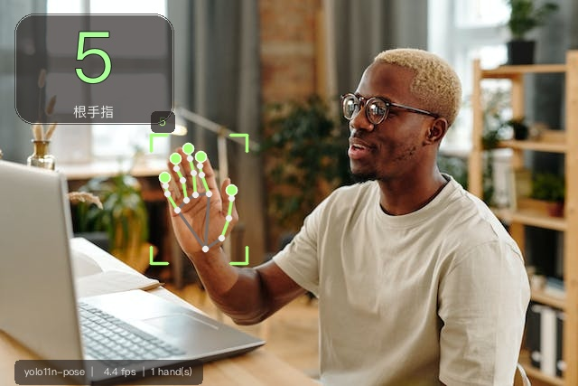

# 摄像头手指计数（YOLO + 21 关键点）

对着摄像头比出 **0~5** 根手指，屏幕上实时显示数字。核心是 **YOLO11n-pose 手部 21 关键点模型** + 一套纯几何的判指算法，不需要自己标注数据、不需要训练。



> 📘 完整原理、串口协议、换权重、自建数据集训练：[`docs/完整技术文档.md`](docs/完整技术文档.md)

> 上图是实际运行截图：绿线是伸长的手指，灰线是弯曲的手指，左上角是总数。

---

## 一、先说结论：为什么不是“YOLO 直接分类 0~5”

我按你的要求先翻了 GitHub 上的同类项目（stars 为查询时数据）：

| 项目 | Stars | 做法 | 借鉴价值 |
|---|---:|---|---|
| [CMU-Perceptual-Computing-Lab/openpose](https://github.com/CMU-Perceptual-Computing-Lab/openpose) | 34.5k | 人体/手部关键点 | 关键点路线的鼻祖，但太重 |
| [cvzone/cvzone](https://github.com/cvzone/cvzone) | 1.3k | MediaPipe + `fingersUp()` | 手指计数最常用的工程封装 |
| [Kazuhito00/hand-gesture-recognition-using-mediapipe](https://github.com/Kazuhito00/hand-gesture-recognition-using-mediapipe) | 770 | MediaPipe + 小型 MLP 分类手势 | 关键点 + 分类器的经典组合 |
| [chrismuntean/YOLO11n-pose-hands](https://github.com/chrismuntean/YOLO11n-pose-hands) | 99 | **YOLO11n-pose 手部 21 关键点** | 本项目的模型来源 |
| [jaredvasquez/CNN-HowManyFingers](https://github.com/jaredvasquez/CNN-HowManyFingers) | 49 | CNN 直接分类 0~5 | 需要采集/标注大量数据 |
| [paveldat/finger_counter](https://github.com/paveldat/finger_counter) | 26 | OpenCV 凸包缺陷 | 只在纯色背景下稳 |

**结论：**

1. “YOLO 目标检测 + 手指计数”这类仓库几乎没有高星的（搜到的都在 3 star 以下），因为它们只能框出整只手，**框本身不含“伸了几根手指”的信息**。
2. 高星方案走的是 **关键点（landmark）** 路线：先拿到 21 个手部关节点，再用几何规则或小分类器判断每根手指的状态。
3. 所以最合理的做法是：**YOLO 负责“手在哪 + 21 个关键点”，我们写算法把关键点翻译成 0~5**。这样既用上了 YOLO，又不用训练分类器，泛化也够用。

我还额外做了一个 **MediaPipe 后备引擎**。原因很现实：这个 YOLO 模型是在“手充满画面”的数据集上训练的，手离镜头远、背景杂乱时会漏检；MediaPipe 对这类场景更稳。默认的 `auto` 模式会**逐帧**判断：YOLO 检到手就用 YOLO 的关键点，某一帧完全没检到就临时交给 MediaPipe 补上，两个引擎共用同一套判指算法。

---

## 二、整体流程

```
摄像头 1280x720
   │
   ├─ 镜像翻转（像照镜子）
   │
   ├─ ① YOLO11n-pose 检测手部框 + 21 关键点（640）
   │      └─ ② 裁出手部区域放大后再跑一次，关键点更准（两段式）
   │
   ├─ ③ 几何判指：每根手指“伸直 / 弯曲”
   │      拇指：关节角度 + 指尖离食指根部的距离
   │      其余四指：PIP/DIP 关节角度 + 指尖相对掌心的伸出量
   │
   ├─ ④ 时序平滑：9 帧多数投票，单帧抖动不会改数字
   │
   └─ ⑤ 绘制：骨架、高亮伸出的手指、左上角大数字、FPS
```

关键点编号采用 MediaPipe 标准（0=手腕，1-4 拇指，5-8 食指，9-12 中指，13-16 无名指，17-20 小指），YOLO 模型输出的顺序与此一致。

### 判指规则（`src/counting.py`）

对食指/中指/无名指/小指：

- 关节角度：PIP、DIP 两处夹角都 ≥ 145°（手指是直的，而不是折回来）；
- 伸出量：指尖沿“手腕→中指根”方向，比 PIP 关节更远 ≥ 8% 掌长。

对拇指：

- MCP、IP 两处夹角 ≥ 135°，并且指尖到食指根部的距离 ≥ 0.62 掌宽（或横向伸出 ≥ 0.55 掌宽）。

全部用 **像素坐标 + 掌宽/掌长归一化**，所以旋转、缩放、手心/手背朝向都不影响结果；单元测试覆盖了旋转、镜像、缩放、握拳、比 2/3/5 等情况。

阈值不是拍脑袋定的：用 HaGRID 的 837 个真实手部关键点做了网格搜索，把几何规则的计数准确率从 **79.2% 提到 84.5%**（拇指从 79.8% 提到 85.7%）。

另外训练了一个 **5 指逻辑回归分类器**（`models/finger_lr.npz`，10 维特征、5 个模型，共几 KB）：
在 HaGRID 验证集上计数准确率 **87%**，拇指 **92%**。它只在 **MediaPipe 引擎**下启用，因为训练数据就是 MediaPipe 关键点；YOLO 关键点分布不同，套用反而会变差（实测过）。

---

## 三、快速开始

环境：macOS（本项目在 macOS 14.8 + Intel x86_64 + Python 3.10 上验证）、Python 3.10 / 3.11 / 3.12（3.13 暂时没有 torch 2.2.2 的安装包）、有摄像头。

```bash
cd ~/Desktop/yolo

# 方式 A：一键脚本（首次会自动建 venv、装依赖、下模型）
./run.sh

# 方式 B：手动
python3 -m venv .venv
source .venv/bin/activate
pip install -r requirements.txt
python tools/download_models.py
python main.py
```

首次运行 macOS 会弹“是否允许访问摄像头”，**必须点允许**。如果误点了拒绝：
`系统设置 → 隐私与安全性 → 摄像头`，把你运行程序的 App（Terminal / PyCharm / iTerm）勾上，然后重启该 App。

### 操作

| 按键 | 作用 |
|---|---|
| `q` / `Esc` | 退出 |
| `s` | 截图到 `out/snapshot_*.jpg` |
| `d` | 保存调试帧 + 关键点 JSON（数字不对时发给开发者） |
| `m` | 切换镜像 |

### 常用参数

```bash
python main.py --backend mediapipe      # 换 MediaPipe 引擎
python main.py --no-refine              # 关掉第二段放大推理，速度快约一倍
python main.py --max-hands 1            # 只检测一只手
python main.py --camera-width 1920 --camera-height 1080
python main.py --source 1               # 换一个摄像头
python main.py --source samples/px_diva-plavalaguna-6937816.jpg   # 跑图片
python main.py --source video.mp4 --headless --record out/demo.mp4  # 跑视频并录制
```

| 参数 | 默认 | 说明 |
|---|---|---|
| `--source` | `0` | 摄像头编号 / 视频 / 图片 |
| `--backend` | `auto` | `auto` 以 YOLO 为主，某帧没检到手时自动用 MediaPipe 补 |
| `--model` | `models/yolo11n-pose-hands.pt` | 权重路径 |
| `--imgsz` | `640` | 第一段检测尺寸，调小更快但更容易漏检 |
| `--conf` | `0.35` | 手部检测阈值，手远/光暗可降到 `0.2` |
| `--max-hands` | `2` | 最多几只手 |
| `--hold` | `0.5` | 新数字要稳定多少秒才显示/发送（0 关闭） |
| `--no-refine` | 关 | 关闭第二段“裁剪放大再推理” |
| `--headless` | 关 | 不弹窗，终端打印（适合跑文件/服务器） |
| `--serial` | 空 | 串口设备，如 `/dev/cu.usbmodem14201`，或 `auto` 自动找 |
| `--serial-baud` | 115200 | 波特率（要和单片机一致） |
| `--serial-hz` | 30 | 串口最大发送频率 |
| `--list-serial` | - | 列出当前可用串口后退出 |

---

## 四、性能实测（本机 Intel Mac）

| 模式 | 单帧耗时 | 约 FPS |
|---|---:|---:|
| 两段式（默认，精度优先） | ~200 ms | ~5 |
| `--no-refine`（单段） | ~95 ms | ~10 |

两段式是精度关键：直接对 1280×720 整帧推理时，手只占一两百像素，关键点会“缩”在掌心；把检测框裁出来放大到 640 再跑一次，指尖位置会准很多（实测同一张图从 1 根变 5 根）。

如果觉得卡：`python main.py --no-refine`，或者把 `--imgsz` 降到 `512`。数字本身有 9 帧平滑，5 FPS 下延迟约 0.4 秒，演示可接受。

---

## 五、目录结构

```
yolo/
├── main.py                 # 入口
├── run.sh                  # 一键安装 + 启动
├── requirements.txt
├── models/
│   ├── yolo11n-pose-hands.pt   # YOLO 手部关键点权重（6 MB）
│   └── finger_lr.npz           # 学习型 5 指分类器（几 KB）
├── firmware/                   # ESP32 + 0.96" OLED（PlatformIO，无需 Arduino IDE）
│   ├── platformio.ini
│   ├── src/main.cpp
│   ├── flash.sh                # 一键编译 + 烧录
│   └── README.md
├── arduino/
│   └── finger_count_receiver/  # 通用单片机接收示例（.ino）
├── data/
│   └── basic_export.csv        # HaGRID 关键点（训练用，20 MB）
├── src/
│   ├── counting.py         # 21 关键点 -> 0~5（几何规则 + 可选分类器）
│   ├── features.py         # 每根手指的归一化特征（训练/推理共用）
│   ├── finger_model.py     # 学习型 5 指分类器（models/finger_lr.npz）
│   ├── backends.py         # YOLO / MediaPipe 两个引擎 + 两段式精修
│   ├── tracking.py         # 多手跟踪 + 时序平滑
│   ├── serial_link.py      # 串口输出（FC 帧协议）
│   ├── draw.py             # 骨架、数字面板、状态条
│   └── app.py              # 主循环、参数、摄像头/文件输入
├── tools/
│   ├── download_models.py     # 走 GitHub API 下模型（绕开被墙的 github.com）
│   ├── eval_images.py         # 批量跑图片，输出计数
│   └── train_finger_model.py  # 用 HaGRID 关键点训练判指分类器
├── tests/test_counting.py  # 11 个单元测试
├── samples/                # 示例图片 / 测试视频
├── docs/
│   ├── demo.jpg
│   └── 完整技术文档.md     # 原理 / 协议 / 换权重 / 自建数据集训练
└── out/                    # 截图 / 录制 / 调试图
```

---

## 六、常见问题

**1. `OpenCV: not authorized to capture video` / 摄像头打不开**
macOS 权限问题。用哪个 App 运行就给哪个 App 授权（Terminal、PyCharm、VS Code…），授权后**完全退出并重开**该 App。也确认没有被 Zoom/微信/OBS 占用。

**2. 模型下载失败**
`python tools/download_models.py` 走的是 GitHub API（`api.github.com`），不依赖被墙的 `github.com`。仍失败的话，手动下载
<https://github.com/chrismuntean/YOLO11n-pose-hands/blob/main/runs/pose/train/weights/best.pt>
保存为 `models/yolo11n-pose-hands.pt`。

**3. 数字不准 / 乱跳 / 一直显示 0**
- 手离镜头太远：手至少占画面高度的 1/3；
- 光线太暗或逆光；
- 试试 `--backend mediapipe` 对比（这个模式会用学习型分类器，拇指更稳）；
- **按 `d` 保存调试图**（`out/debug_*.jpg` + `.json`），能看到骨架、每根手指的角度和概率，发我就能定位；
- 打开逐帧调试图：`python main.py --dump-dir out/debug --dump-every 10`。

**4. 为什么 YOLO 有时漏检？**
这个 6 MB 的 nano 模型训练集以“手充满画面”的图片为主（作者 README 也说明捏合、滑动等手势不稳）。它擅长“手举在镜头前”，不擅长“手在远处的小目标”。要更稳可以换更大的 `yolo11s-pose` 手部模型重训，或直接用 MediaPipe。

**5. 想识别左右手？**
MediaPipe 引擎会给出 `Left/Right` 并显示“左手/右手”；YOLO 模型只有一个 `hand` 类，暂不区分。

---

## 七、把数字通过串口发给单片机

可以，已经内置。识别结果会以 ASCII 行发给单片机，**只在数字变化时发送**，另外每秒补一帧心跳（断线/丢帧后单片机能自己恢复显示）。

### 接线

- 大多数开发板（Arduino Uno/Leonardo、ESP32、STM32 带 USB CDC、STC 下载器）**一根 USB 线直连电脑**即可，不需要额外杜邦线。
- 如果用 UART 引脚（TX/RX）接 USB-TTL：记得 **共地（GND）**，逻辑电平要匹配（3.3V 单片机不要直接接 5V TTL 输出）。
- 不要接真正的 RS-232 电平（±12V），会烧板子。

### 使用

```bash
# 1. 先看电脑认到了哪个串口（插上板子后）
./run.sh --list-serial

# 2. 指定串口运行（macOS 选 /dev/cu.*）
./run.sh --serial /dev/cu.usbmodem14201

# 或者让程序自己找（推荐；换 USB 口、热插拔后会自动重新查找）
./run.sh --serial auto
```

> 换 USB 口后 macOS 可能把设备名从 `usbserial-1420` 改成 `usbserial-1410` 之类。
> 用 `--serial auto` 就不用改命令；写死端口名的话，换口后要重新 `--list-serial` 确认。

连接成功后，画面左下角状态条会多一个 `SER` 标记，OLED 右上角会显示左右手徽标。

**防抖：** 新数字要连续稳定 `--hold` 秒（默认 0.5）才会显示和发送；手短暂丢失 0.6 秒内保持上一个数字，不会闪 0。觉得反应慢可以 `--hold 0.3`，想更稳就 `--hold 0.8`。

终端会打印：

```
[serial] 已连接 /dev/cu.usbmodem14201 @ 115200 8N1
[serial] 等待单片机启动 1.5s …
```

（Arduino Uno 打开串口会自动复位，所以特意留了 1.5 秒。）

### 协议

ASCII、`115200 8N1`、一行一帧、`\n` 结尾：

```
FC <total> <n_hands> [count_1[:L|R] count_2[:L|R] ...]
```

| 场景 | 实际发送 |
|---|---|
| 没检测到手 | `FC 0 0` |
| 右手，3 根 | `FC 3 1 3:R` |
| 两只手，2 + 3 根 | `FC 5 2 2:L 3:R` |
| 左右手未知（YOLO 引擎） | `FC 4 1 4` |

> `L`/`R` 来自 MediaPipe 的手性判断，YOLO 权重只输出关键点、不输出左右手。
> 想要 OLED 上的 L/R 徽标，请用 `--backend mediapipe`。

单片机端解析（Arduino）：

```cpp
int total, hands;
if (sscanf(line + 3, "%d %d", &total, &hands) == 2) {
  // total 就是手指总数
}
```

完整示例：
- ESP32 + 0.96" OLED（**推荐，不需要 Arduino IDE**）：[`firmware/`](firmware/README.md)
- 通用 Arduino 接收示例：[`arduino/finger_count_receiver/finger_count_receiver.ino`](arduino/finger_count_receiver/finger_count_receiver.ino)

ESP32 的接线是 `VCC→3V3、GND→GND、SCL→GPIO22、SDA→GPIO21`，插上板子后运行 `firmware/flash.sh` 即可编译烧录。

### 没有硬件时怎么测

```bash
# loop:// 是 pyserial 的虚拟串口，写进去的数据直接丢弃，用来验证不报错
./run.sh --serial loop:// --headless --source samples/px_diva-plavalaguna-6937816.jpg
```

想看到真实字节，可以用 `screen` 或 Arduino IDE 的串口监视器（**同一时间只能有一个程序占用串口**，跑本程序前先关掉监视器）：

```bash
screen /dev/cu.usbmodem14201 115200
```

### 常见问题

- **打不开串口 / Permission denied**：先关掉 Arduino IDE 的串口监视器、其他串口工具；macOS 选 `/dev/cu.*` 而不是 `/dev/tty.*`。
- **单片机收到乱码**：两边波特率不一致，或选了错误的口。程序默认 115200，用 `--serial-baud 9600` 可改。
- **数字不动**：只在变化时发送 + 每秒心跳，属正常；可以看终端有没有 `SER` 和串口日志。
- **51 单片机**：把 `Serial.begin(115200)` 改成你的晶振支持的波特率（如 9600），电脑端加 `--serial-baud 9600`。

---

## 八、可以继续做的方向

1. **手势命令**：把 0~5 映射成播放/暂停、音量、PPT 翻页（加一个“手势稳定 500ms 才触发”即可）。
2. **双手合计**：现在已支持两只手，左上角显示总和；也可以改成两只手分别显示。
3. **自定义训练**：用 `ultralytics` 把自己的手部数据（或 0~5 分类数据）微调，替换 `models/*.pt`。
4. **打包成 App**：`py2app` / `PyInstaller`，免去终端和 Python 环境。

---

## 九、致谢与说明

- 权重来自 [chrismuntean/YOLO11n-pose-hands](https://github.com/chrismuntean/YOLO11n-pose-hands)，训练数据为 Rion Dsilva 的 *Hand Keypoint Dataset 26K*；仓库未声明开源许可证，**仅供学习/个人演示**，商用前请自行确认授权。
- 示例图片来自 [cj-mills/pexel-hand-gesture-test-images](https://huggingface.co/datasets/cj-mills/pexel-hand-gesture-test-images)（Pexels）。
- 本项目代码可自由修改使用。
